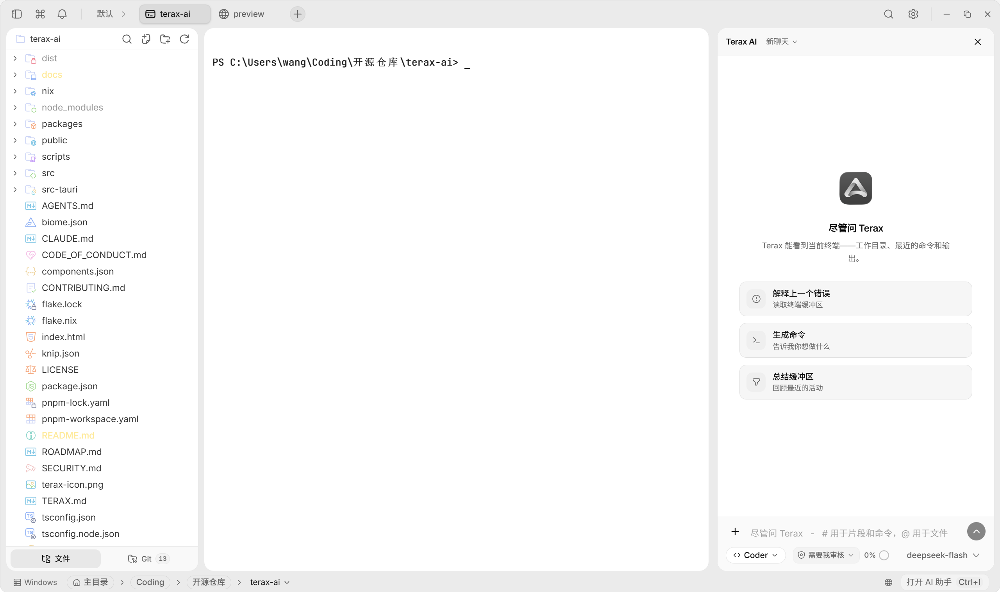
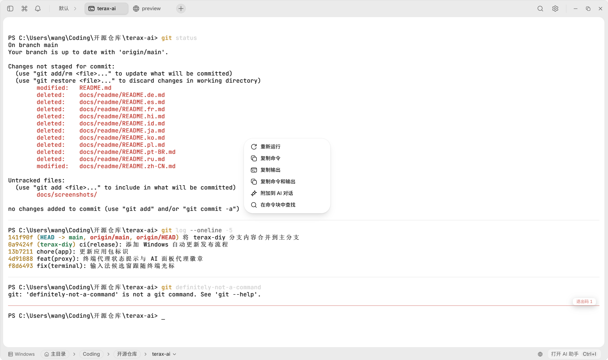
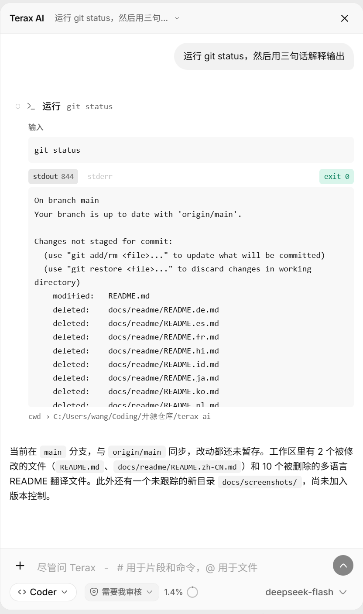
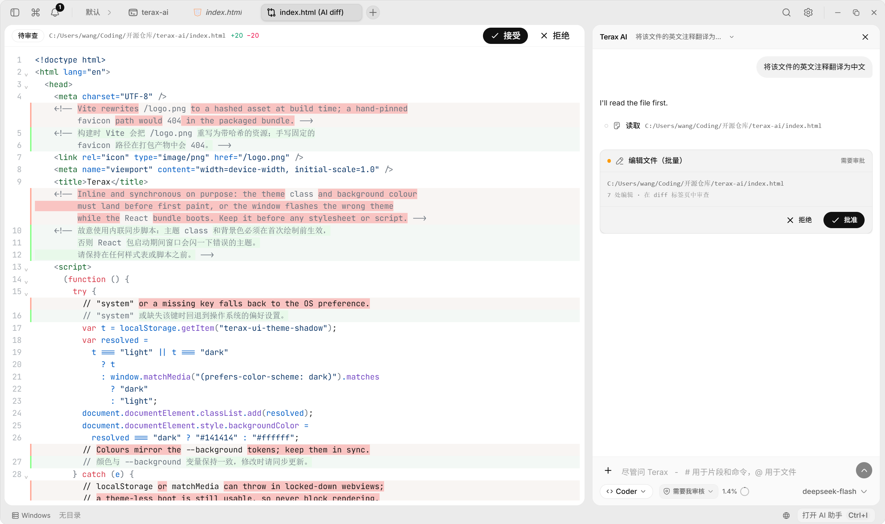
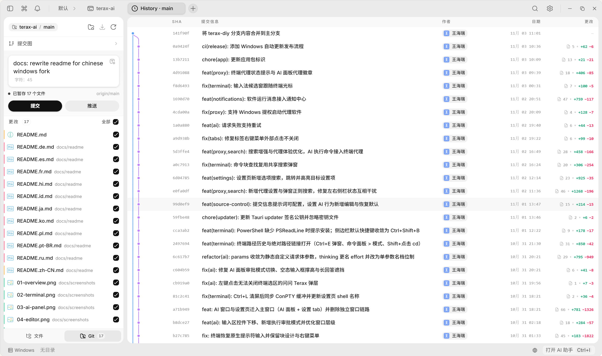
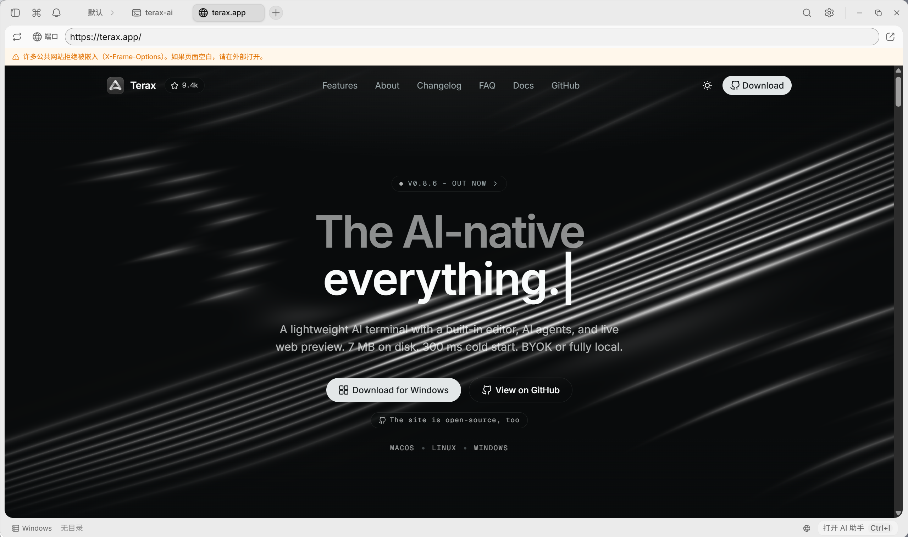
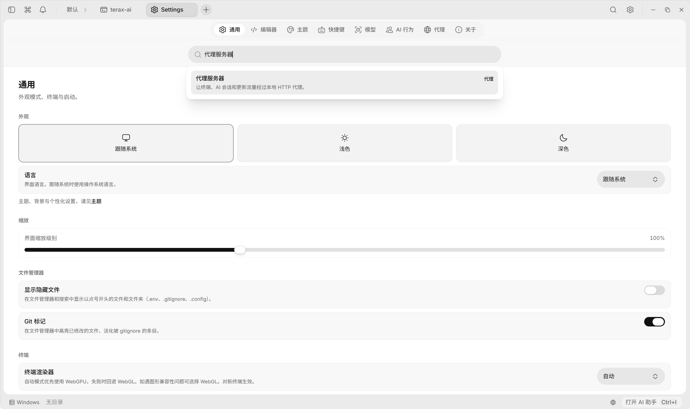
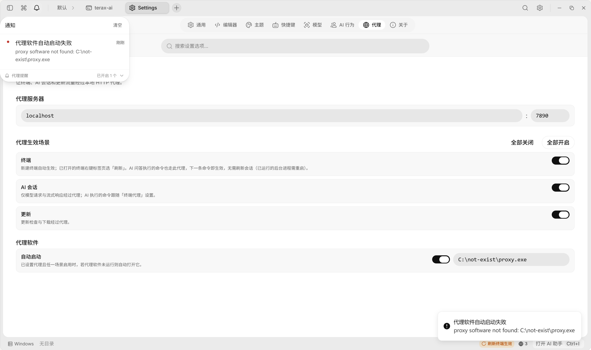

> **本项目基于 [crynta/terax-ai](https://github.com/crynta/terax-ai) 二次开发。** 上游项目、原作者与贡献者的版权归其所有。本仓库是面向中文用户和 Windows 使用场景的定制版本，与上游作者无隶属关系。

  
  <h1>Terax</h1>

  
<strong>轻量、终端优先的 AI 原生开发工作区</strong>

  
终端、编辑器、文件管理、Git、网页预览和 AI 助手，全在一个桌面窗口里。

  

    
    
    
  

  

    <a href="https://github.com/lsnu73/terax-ai/releases">下载安装包</a>
    ·
    <a href="#安装">安装说明</a>
    ·
    <a href="#常用快捷键">常用快捷键</a>
    ·
    <a href="docs/atlas/README.md">开发文档</a>
  

---

Terax 把日常开发需要的几个入口放进同一个窗口：多标签终端、代码编辑器、文件管理器、Git 源代码管理和网页预览，右侧还有一个能读取当前终端上下文的 AI 助手。它使用原生 PTY 和 GPU 终端渲染，模型服务由你自己配置，密钥保存在系统钥匙串中。不需要登录，不收集使用数据。

本项目目前**只发布 Windows 安装包**，macOS 和 Linux 需要自行从源码构建，详见[开发与构建](#开发与构建)。

## 目录

- [本版本与上游的差异](#本版本与上游的差异)
- [界面截图](#界面截图)
- [功能特性](#功能特性)
- [安装](#安装)
- [快速上手](#快速上手)
- [配置 AI](#配置-ai)
- [使用代理](#使用代理)
- [常用快捷键](#常用快捷键)
- [数据与隐私](#数据与隐私)
- [常见问题](#常见问题)
- [开发与构建](#开发与构建)
- [致谢与许可证](#致谢与许可证)

## 本版本与上游的差异

本仓库来自 [crynta/terax-ai](https://github.com/crynta/terax-ai)，在上游基础上主要做了这些调整：

- **中文界面**：内置简体中文，可跟随系统语言，也可手动切换中英文。
- **国内模型服务商预置**：内置智谱 GLM、DeepSeek、阿里云百炼 Qwen、月之暗面 Kimi、火山方舟豆包、硅基流动、MiniMax、阶跃星辰、腾讯混元、百度千帆等厂商条目；也支持任意 OpenAI 兼容、Anthropic、Google 协议端点和本地模型。
- **代理支持**：终端、AI 会话和更新流量可以分别走本地 HTTP 代理，并支持自动拉起代理软件。
- **通知中心**：顶栏铃铛统一显示编码代理活动和软件运行消息，可以选择直接弹出消息，或只显示未读角标。
- **终端增强**：所有终端统一使用命令与结果块，支持块内右键重跑、复制、附加到 AI 对话和查找；新增最近路径、路径链接分流、Windows 输入法候选窗跟随光标等细节。
- **设置与效率**：设置页支持跨分区搜索；命令面板支持文件内容搜索和路径历史；预览页支持自定义端口预设；按钮悬浮提示会显示当前生效的快捷键。
- **AI 体验**：请求失败可重试；支持“需要我审核”和“直接执行”两种审批模式；模型参数与思考强度可配置；AI 生成提交信息的提示词可修改和恢复默认。
- **发布范围**：只提供 Windows 安装包，并附带自动更新流程。macOS 和 Linux 暂不构建。

## 界面截图

以下截图使用简体中文界面，实际界面以当前版本为准。

<table>
  <tr>
    <td colspan="2" align="center">
      
       主界面：左侧文件树，中间终端与标签栏，右侧 AI 面板，底部状态栏
    </td>
  </tr>
  <tr>
    <td align="center">
      
       命令与结果块：失败命令显示退出码，右键可重跑、复制、附加到 AI 或块内查找
    </td>
    <td align="center">
      
       AI 面板：中文对话、工具审批卡片、模型与执行审批模式
    </td>
  </tr>
  <tr>
    <td align="center">
      
       编辑器与 AI 差异：逐块接受或拒绝修改，Markdown 和媒体文件可直接预览
    </td>
    <td align="center">
      
       源代码管理：暂存文件、AI 生成提交信息、查看提交图
    </td>
  </tr>
  <tr>
    <td align="center">
      
       网页预览：本地开发服务器预览和常用端口菜单
    </td>
    <td align="center">
      
       设置与代理：终端、AI 会话、更新三类代理独立开关
    </td>
  </tr>
  <tr>
    <td colspan="2" align="center">
      
       通知中心：编码代理活动和软件运行消息，支持直接弹出或仅显示未读角标
    </td>
  </tr>
</table>

## 功能特性

### 终端

- 原生 PTY，多标签、水平与垂直分屏、拖拽排序、标签重命名和右键菜单。
- Windows 自动检测 Shell：`pwsh.exe`（PowerShell 7+）→ `powershell.exe`（Windows PowerShell 5.1）→ `cmd.exe`。
- WSL 是一等工作区环境。每个终端标签可以单独选择 Windows 本地或任意已安装的 WSL 发行版。
- 终端内核基于 libghostty-vt，默认使用 WebGPU 渲染，遇到图形兼容问题时自动回退到 WebGL。
- 所有终端统一使用命令与结果块。失败命令显示红色分隔线和退出码；右键命令块可以重新运行、复制命令、复制输出、复制命令和输出、附加到 AI 对话，或在当前块中查找。
- 全文查找支持正则、区分大小写和全字匹配；命令块内查找复用同一个搜索弹窗。
- 按住 `Ctrl` 点击 URL 会在系统浏览器打开，`Shift` 点击 URL 会在内置预览标签打开。按住 `Ctrl` 点击绝对路径会在文件管理器中打开，`Shift` 点击路径会在当前终端执行 `cd`。
- 把文件从文件树或桌面拖入终端，会自动转换成适合 Shell 的安全引用路径。
- `Ctrl+E` 打开“最近路径”弹窗，可直接在当前终端切换到历史目录；命令面板输入 `>` 也可以搜索历史路径。
- 隐私终端（`Ctrl+Shift+T`）的输出不会发送给 AI，适合密码、SSH 和其他敏感内容。
- Windows 中文输入法的候选窗会跟随终端光标，不再固定在窗口一角。
- 后台标签继续接收输出，切换标签不会丢失正在运行的命令结果。
- 空间会保存并恢复标签、工作目录和分屏布局，重新打开应用后接着用。

### AI 助手

- `Ctrl+I` 在主窗口右侧打开或关闭 AI 面板，面板可拖拽调宽，宽度会自动记住。
- 使用你自己的 API Key 或本地模型。密钥只保存在操作系统钥匙串中，不写入磁盘配置文件。
- 内置多家国内模型服务商条目，也支持 OpenAI 兼容、Anthropic、Google 协议的自定义端点。
- AI 可以读取当前终端的工作目录、最近命令和输出，也可以读取你附加的文件、图片或编辑器选区。
- 工具能力包括：读取文件、列目录、写入文件、编辑文件、批量编辑、创建目录、`grep`、`glob`、运行 Shell 命令、启动后台进程、读取后台日志、终止后台进程、读取终端输出、打开预览、维护待办列表和调用子代理。
- 执行审批：可以在输入区下方选择“需要我审核”或“直接执行”。审核模式下，写文件和运行命令前会弹出确认卡片；AI 对文件的修改会进入差异标签页，可逐块接受或拒绝。
- 计划模式：先给出多步计划，确认后再执行；计划中的修改可以逐项应用或全部丢弃。
- 内置 Coder、Architect、Code Reviewer、Security、Designer 等角色，也可以创建自定义角色，为角色单独设置系统提示词和工具范围。
- 输入区支持 `#片段`、`@文件`、图片和附件；终端或编辑器选中内容后可以按 `Ctrl+J` 直接“问问 Terax”。
- 会话可以切换、新建和删除，输入区下方会显示上下文用量；请求失败时错误卡片提供“重试”。
- 工作区根目录的 `TERAX.md` 会作为项目记忆注入 AI 上下文，适合记录项目约定和长期任务。
- 开启代理后，AI 面板头部会显示“代理中”徽章，并说明哪些场景正在走代理。
- 源代码管理面板可以让 AI 根据已暂存的改动生成一行 Conventional Commit 提交信息，提示词可在“设置 → AI 行为”中修改和恢复默认。
- 可以在新建标签菜单里一键启动 Claude Code、Codex、Gemini CLI、OpenCode 等外部编码代理（需要本机已安装对应命令），并在通知中心查看它们是否需要输入或已经完成。

### 代码编辑器

- 基于 CodeMirror 6，支持 TypeScript/JavaScript、Rust、Python、Go、C/C++、Java、HTML/CSS、JSON、Markdown 等常用语言。
- Vim 模式、自动保存、保存时格式化、自动换行和字号调整。
- 可选的语言服务器支持：诊断、跳转、补全、格式化和自定义 LSP 服务器。
- AI 行内补全，可为补全单独选择模型和触发方式。
- Markdown 可直接渲染预览；图片、视频、音频和 PDF 可以在编辑器标签中查看。
- 审核模式下，AI 对文件的修改会以差异标签页呈现，支持逐块接受或拒绝。
- 编辑器主题独立于应用主题，内置 Kanagawa、Catppuccin、Rosé Pine、Everforest、Dracula、Solarized、Nord、Tokyo Night、GitHub、Xcode 等配色。

### 文件管理

- 文件树跟随当前活动终端的工作目录。在终端 `cd` 到项目目录，文件树、Git 面板和 AI 上下文都会跟着切换。
- 模糊搜索、键盘导航、隐藏文件开关、Git 状态标记和磁盘变更实时刷新。
- 右键菜单支持新建文件/文件夹、重命名、删除、复制路径、在终端中打开、在源代码管理中打开、在系统文件管理器中显示、附加到 AI 等操作。
- 支持拖放移动、复制、粘贴和删除，删除前需要二次确认。

### 源代码管理

- `Ctrl+G` 打开源代码管理面板，支持暂存和取消暂存文件、提交（`Ctrl+Enter`）和推送。
- 显示当前分支和分离 HEAD 状态，支持从远程获取、快进拉取和上游分支提示。
- Git 历史标签页提供真实的提交图，合并和分支会按轨道渲染；支持提交搜索和筛选。
- 暂存改动后可让 AI 生成提交信息，生成结果会填入提交框。

### 网页预览

- `Ctrl+Shift+O` 新建预览标签，输入 URL 即可预览本地开发服务器或外部网站。
- 端口菜单内置 Vite、Next.js 等常用端口，也可以添加、编辑和删除自定义端口预设，重启后保留。
- 选择端口时会先检查该端口是否有服务在监听，没有监听会给出提示。
- 公共网站可能通过 X-Frame-Options 拒绝嵌入；Cookie 登录在沙盒预览中也可能不可用。遇到空白页时可以用“在系统浏览器中打开”。
- 长时间处于后台的预览会自动挂起以释放内存，需要时重新加载。

### 空间、标签与主题

- 空间用于保存一组标签、工作目录、终端环境和分屏布局，可在空间之间切换、重命名和删除。
- `Ctrl+Shift+S` 打开空间总览，`Ctrl+Shift+]` 和 `Ctrl+Shift+[` 切换下一个/上一个空间。
- 新建标签菜单提供终端、代理、隐私终端、编辑器、预览和 Git 图谱。
- 标签支持拖拽排序、关闭右侧标签和关闭其他标签；终端标签还支持重命名和刷新。
- 内置多套主题，也可以在应用内新建主题，或导入 `.terax-theme` 主题文件（自己创建或别人分享的都可以）。
- 支持背景图片、不透明度和模糊调整；编辑器主题可以独立设置。
- Windows 11 支持 Mica 背景，窗口虚化可让标题栏、状态栏和侧边栏融入桌面壁纸。

### 设置与效率

- 设置页是主窗口内的一个标签页，`Ctrl+,` 打开。包含通用、编辑器、主题、快捷键、模型、AI 行为、代理和关于。
- 设置页顶部搜索框可以跨分区查找设置项，选中后自动跳到对应位置并短暂高亮。
- 快捷键可以在设置页修改；与 Shell 自带按键冲突时会提示，例如 `Ctrl+R` 保留给终端的反向历史搜索。
- 命令面板 `Ctrl+K` 支持模糊搜索命令、按最近使用排序、用 `#` 前缀搜索工作区文件内容、用 `?` 查看搜索模式帮助。
- 鼠标悬浮在带快捷键的按钮上时，提示会显示当前生效的键位；改键后立即同步。
- 内置开发者工具入口，方便排查界面问题；发行版也可以按 `F12` 或 `Ctrl+Alt+I` 打开。
- 禅模式可以隐藏多余界面，只保留当前工作区。

## 安装

### Windows（当前唯一提供安装包的平台）

**系统要求**

- Windows 10 或 Windows 11，64 位。
- 需要 WebView2 运行时。安装包在系统缺少 WebView2 时会自动下载安装引导，需要联网。
- 建议使用 PowerShell 7（`pwsh.exe`）。没有时会回退到 Windows PowerShell 5.1 或 `cmd.exe`。

**安装步骤**

1. 打开本仓库的 [Releases](https://github.com/lsnu73/terax-ai/releases) 页面。
2. 下载 Windows 安装包，文件名形如 `Terax_x.y.z_x64-setup.exe`。
3. 双击安装。安装程序按当前用户安装，通常不需要管理员权限。
4. 首次启动如果 Windows SmartScreen 提示“未知发布者”，请先核对下载来源，再选择“更多信息 → 仍要运行”。
5. 安装完成后，应用会在启动时自动检查更新，也可以在“设置 → 关于”中手动检查更新。

> **关于代码签名**：本仓库的 Windows 安装包目前没有做代码签名，SmartScreen 或部分安全软件可能给出未知发布者或风险提示。请只从本仓库的 Releases 页面下载安装包。

安装程序还会在 Windows 资源管理器中注册“Open in Terax”。右键文件夹、文件夹空白处或磁盘，可以直接用 Terax 打开该目录。Windows 11 如果只看到精简菜单，可以点“显示更多选项”后再选择。

**卸载**

打开 Windows 的“设置 → 应用 → 已安装的应用”，找到 Terax 后卸载。卸载默认不会删除应用数据；如需彻底清理，见[数据与隐私](#数据与隐私)。

**如果 Releases 页面暂时没有安装包**

说明该版本还没有发布构建产物。可以按[开发与构建](#开发与构建)中的文档，从源码构建 Windows 安装包。

### macOS 和 Linux

本仓库目前**不提供 macOS 和 Linux 安装包**。

- 上游项目支持 macOS 和 Linux，但上游安装包不包含本仓库的中文界面、代理、通知中心等改动，请勿混用。
- 如需在 macOS 或 Linux 上使用本版本，需要自行从源码构建，构建步骤和平台依赖见 [docs/atlas/getting-started.md](docs/atlas/getting-started.md)。

## 快速上手

1. **切换界面语言**：默认跟随系统语言。如果系统不是中文，打开“设置 → 通用 → 语言”，选择“中文”。
2. **打开项目**：启动后默认打开一个终端，工作目录通常是用户主目录。在终端里 `cd` 到项目目录即可，文件树、Git 面板和 AI 上下文都会跟随当前终端目录。也可以在资源管理器中右键文件夹，选择“Open in Terax”。
3. **新建标签**：点击标签栏右侧的 `+`，可以选择终端、隐私终端、编辑器、预览、Git 图谱，或启动外部编码代理。
4. **分屏**：`Ctrl+D` 向右拆分，`Ctrl+Shift+D` 向下拆分，`Ctrl+Shift+Z` 撤销最近一次拆分。
5. **打开 AI**：按 `Ctrl+I` 打开右侧 AI 面板。第一次使用需要先配置模型，见[配置 AI](#配置-ai)。
6. **打开 Git**：按 `Ctrl+G` 打开源代码管理面板。当前目录必须是 Git 仓库。
7. **打开预览**：按 `Ctrl+Shift+O` 新建预览标签，输入本地开发服务器地址，或从端口菜单选择端口。
8. **使用空间**：`Ctrl+Shift+S` 打开空间总览，把不同项目的标签、目录和分屏布局分开保存。

## 配置 AI

Terax 不提供内置模型额度，使用你自己的模型服务。配置入口是“设置 → 模型”（`Ctrl+,` 打开设置）。

### 使用在线模型

1. 在“设置 → 模型”中选择一家厂商。内置条目包括智谱 GLM、DeepSeek、阿里云百炼 Qwen、月之暗面 Kimi、火山方舟豆包、硅基流动、MiniMax、阶跃星辰、腾讯混元、百度千帆。
2. 填写该厂商的 API Key。密钥会写入系统钥匙串，不会写进 `terax-ai-models.json`，也不会进入 localStorage。
3. 添加模型。可以点击“获取模型列表”从厂商的模型列表接口拉取，也可以手动填写模型 ID。
4. 部分厂商没有模型列表接口，例如智谱、火山方舟和 MiniMax，需要从厂商控制台复制模型 ID 后手动添加。
5. 选择一个默认模型。之后可以在 AI 面板底部的模型选择器中切换，支持搜索、收藏和最近使用。

### 使用本地模型

1. 在“设置 → 模型”中添加“自定义 / 本地 (OpenAI 兼容)”厂商。
2. 填写本地服务的 Base URL，例如：
   - Ollama：`http://localhost:11434/v1`
   - LM Studio：`http://localhost:1234/v1`
3. 填写模型 ID。密钥可以留空，是否需要密钥取决于本地服务的配置。
4. 保存后在模型选择器中选择该模型。

### 调整思考强度

模型选择器底部有“思考强度”滑条。档位由厂商配置决定，常见档位是关闭、低、中、高、最高。关闭或低档位可以降低终端场景下的延迟。

### 选择执行审批模式

AI 面板输入区下方的元信息行可以切换执行审批模式：

- **需要我审核**：执行命令或修改文件前先弹出确认卡片。推荐日常使用。
- **直接执行**：命令和文件修改不再逐次确认。只在你信任当前模型和任务时使用。

审核模式下，AI 对文件的修改会生成差异标签页，可以逐块接受或拒绝。直接执行模式会跳过确认和差异审查，请谨慎使用。无论哪种模式，常见密钥路径和系统危险目录仍会被安全规则拦截。

### 请求失败与重试

模型请求失败时，聊天中会显示错误卡片和“重试”按钮。重试会重新请求失败的助手回合，不会重复追加原来的用户消息。如果已执行过工具，重新生成可能会再次执行工具，需要留意。

### 直接编辑模型配置

所有 Provider、模型、请求参数和思考档位最终都保存在应用数据目录下的 `terax-ai-models.json`。设置页只是这份文件的图形编辑器。文件格式和字段说明见 [docs/atlas/features/AI模型配置.md](docs/atlas/features/AI模型配置.md)。

## 使用代理

如果你的网络需要通过本地代理访问模型服务或更新服务器，可以在“设置 → 代理”中配置。状态栏右下角和 AI 面板也会显示代理状态。

- **代理地址**：默认 `localhost`，端口默认 `7890`。只支持 HTTP 代理，不支持 SOCKS 或代理认证。
- **终端**：新建终端会自动注入代理环境变量。已经打开的终端需要右键标签选择“刷新”，或点击状态栏的“刷新终端生效”按钮。AI 在终端执行的命令会在下一条命令生效；已经运行的后台进程需要重启。
- **AI 会话**：只让模型请求和流式响应经过代理。AI 执行的命令跟随“终端”场景的开关。
- **更新**：更新检查和下载经过代理。下载失败时可以检查这个开关，或到 Releases 页面手动下载。
- **全部开启 / 全部关闭**：一次性切换三个场景。
- **代理软件自动启动**：填写代理软件的启动路径并打开“自动启动”。当已配置代理、任一场景启用且代理软件没有运行时，Terax 会尝试启动它。
- **Windows 提权**：如果代理软件需要管理员权限，启动时会弹出 UAC 提示。取消或启动失败会在通知中心显示原因。

代理只影响新创建的终端和新发起的请求。代理设置变化后，状态栏会提示是否需要刷新已经打开的终端。AI 面板头部的“代理中”徽章只表示代理已生效，不提供开关；开关在“设置 → 代理”或状态栏代理按钮中。

## 常用快捷键

下表是 Windows 默认键位。macOS 上 `Ctrl` 对应 `Cmd`。大部分快捷键可以在“设置 → 快捷键”中修改，冲突时会提示。

| 操作 | 快捷键 |
|---|---|
| 打开命令面板 | `Ctrl+K` |
| 在文件中搜索内容 | `Ctrl+Shift+P` |
| 打开设置 | `Ctrl+,` |
| 打开或关闭 AI 面板 | `Ctrl+I` |
| 就选中的内容询问 AI | `Ctrl+J` |
| 新建终端标签 | `Ctrl+T` |
| 新建隐私终端 | `Ctrl+Shift+T` |
| 新建编辑器标签 | `Ctrl+Alt+E` |
| 新建网页预览 | `Ctrl+Shift+O` |
| 关闭标签或窗格 | `Ctrl+W` |
| 下一个标签 | `Ctrl+Tab` |
| 上一个标签 | `Ctrl+Shift+Tab` |
| 向右拆分窗格 | `Ctrl+D` |
| 向下拆分窗格 | `Ctrl+Shift+D` |
| 撤销最近一次拆分 | `Ctrl+Shift+Z` |
| 聚焦下一个窗格 | `Ctrl+]` |
| 聚焦上一个窗格 | `Ctrl+[` |
| 切换源代码面板 | `Ctrl+G` |
| 终端最近路径 | `Ctrl+E` |
| 在标签页中查找 | `Ctrl+F` |
| 搜索文件 | `Ctrl+Shift+F` |
| 切换左侧侧边栏 | `Ctrl+Shift+B` |
| 聚焦文件管理器 | `Ctrl+Shift+E` |
| 空间总览 | `Ctrl+Shift+S` |
| 下一个空间 | `Ctrl+Shift+]` |
| 上一个空间 | `Ctrl+Shift+[` |
| 打开开发者工具 | `F12` 或 `Ctrl+Alt+I` |
| 提交（源代码管理） | `Ctrl+Enter` |
| 保存文件 | `Ctrl+S` |
| 放大 / 缩小 / 重置缩放 | `Ctrl+=` / `Ctrl+-` / `Ctrl+0` |
| 禅模式 | `Ctrl+Shift+'` |

终端内还有一些按键保留给 Shell 本身：

- `Ctrl+R` 是 Shell 的反向历史搜索，不会被 Terax 占用。
- `Ctrl+C` 用于中断当前命令。
- `Ctrl+L` 在 Windows 的 PowerShell 提示符下清屏。

## 数据与隐私

- **无账号、无遥测**：Terax 不需要登录，应用本身不收集使用数据，也不内置分析或上报 SDK。
- **API Key**：只保存在操作系统钥匙串（Windows 凭据管理器）中，不写入 `terax-ai-models.json` 或 localStorage。
- **本地数据**：设置、模型配置、AI 会话和空间状态保存在应用数据目录，Windows 通常为 `%APPDATA%\app.wang.terax`。
- **网络请求**：模型请求只发往你配置的模型服务端点；更新检查只访问本仓库的 GitHub Releases。
- **AI 文件访问**：AI 工具以当前终端工作目录为基准，也允许使用绝对路径。常见的密钥路径（如 `.env`、`.ssh`、凭据文件）会被拒绝读写，危险的系统写入位置也会被拦截；写文件和运行命令还需要你确认（审核模式下）。
- **隐私终端**：隐私终端的输出不会进入 AI 上下文，状态栏会显示“隐私：对 AI 不可见”。
- **彻底清理**：关闭 Terax 后删除 `%APPDATA%\app.wang.terax` 会清除设置、模型配置、会话和空间数据。API Key 还需要在 Windows 凭据管理器中单独删除。

## 常见问题

**安装时提示“未知发布者”或 SmartScreen 拦截**

当前安装包没有做代码签名，这是正常现象。请确认安装包来自本仓库的 Releases 页面，再选择“更多信息 → 仍要运行”。如果安全软件误报，可以把安装包加入信任列表，或从源码自行构建。

**界面是英文，怎么换成中文**

打开“设置 → 通用 → 语言”，选择“中文”。选择“跟随系统”时会使用操作系统语言。

**AI 提示“尚未配置模型”**

在“设置 → 模型”中添加厂商和模型。填好 API Key 后，点击“获取模型列表”或手动添加模型 ID，再选择一个默认模型。

**模型列表拉不出来**

部分厂商不提供模型列表接口，例如智谱、火山方舟和 MiniMax。请到厂商控制台复制模型 ID，然后在设置页手动添加。

**AI 请求失败**

先检查 API Key、模型 ID、账户余额和网络。如果使用代理，确认“AI 会话”场景已开启，并且代理地址和端口正确。错误卡片上的“重试”可以重新请求失败的回合。

**终端代理开了，但命令没有走代理**

终端代理只对新建终端生效。已经打开的终端需要右键标签选择“刷新”，或点击状态栏的“刷新终端生效”按钮。AI 执行的命令会在下一条命令生效，已经运行的后台进程需要重启。

**代理软件没有自动启动**

检查“设置 → 代理”中的软件路径是否正确，以及是否打开了“自动启动”。需要管理员权限的代理软件会弹出 UAC；取消或失败的原因会显示在通知中心。

**命令块不显示，或者不能重新运行**

命令块依赖 Shell 上报命令边界。PowerShell 需要 PSReadLine；缺少时终端会提示，并提供可复制的安装命令。某些旧版 Shell 可能不支持命令块，但终端本身仍然可以正常使用。

**WSL 怎么用**

状态栏有“工作区环境”选择器，可在 Windows 本地和已安装的 WSL 发行版之间切换。每个终端标签可以单独选择环境。WSL 是一等工作区环境，不是包装出来的子进程。

**预览页面空白**

公共网站可能通过 X-Frame-Options 拒绝被嵌入，基于 Cookie 的登录在沙盒预览中也可能不可用。点击预览地址栏右侧的“在系统浏览器中打开”即可。

**更新下载失败**

检查“设置 → 代理”中的“更新”场景，或到本仓库 Releases 页面手动下载最新安装包覆盖安装。

**为什么没有 macOS 和 Linux 安装包**

当前阶段只构建 Windows 版本。macOS 和 Linux 需要自行从源码构建，步骤见 [docs/atlas/getting-started.md](docs/atlas/getting-started.md)。

## 开发与构建

本 README 面向使用 Terax 的用户，不展开构建和开发细节。准备参与开发、修改代码或自行构建时，请从这些文档开始：

| 文档 | 内容 |
|---|---|
| [docs/atlas/README.md](docs/atlas/README.md) | 项目地图：功能清单、代码定位和“我要改 X 该看哪里” |
| [docs/atlas/getting-started.md](docs/atlas/getting-started.md) | 本地运行、构建、检查命令和常见环境问题 |
| [docs/README.md](docs/README.md) | 架构专题索引：进程模型、PTY、安全、AI 子系统、渲染器等 |
| [TERAX.md](TERAX.md) | 架构事实源，修改代码前必读 |
| [CONTRIBUTING.md](CONTRIBUTING.md) | 贡献流程、质量要求和代码规范 |
| [docs/contributing/testing.md](docs/contributing/testing.md) | 测试契约和核心子系统测试要求 |

macOS 和 Linux 的构建方式与 Windows 相同，只是需要额外安装对应平台的 Tauri 前置依赖。具体前置要求、构建步骤和排障方法统一维护在 [docs/atlas/getting-started.md](docs/atlas/getting-started.md)，避免 README 与开发文档出现两份不一致的说明。

## 致谢与许可证

- 感谢 [crynta/terax-ai](https://github.com/crynta/terax-ai) 的作者和所有贡献者，本项目的绝大部分基础能力来自上游。
- 终端内核基于 Ghostty 的 libghostty-vt，WebGL 回退渲染器基于 xterm.js 的适配实现。
- 本项目使用 Apache-2.0 许可证，详见 [LICENSE](LICENSE)。安装包内随附第三方许可证文件。
- 本仓库是社区二次开发版本，与上游作者无隶属关系；上游项目名称、图标和商标归其所有者。

有问题或建议，欢迎到 [Issues](https://github.com/lsnu73/terax-ai/issues) 反馈。
